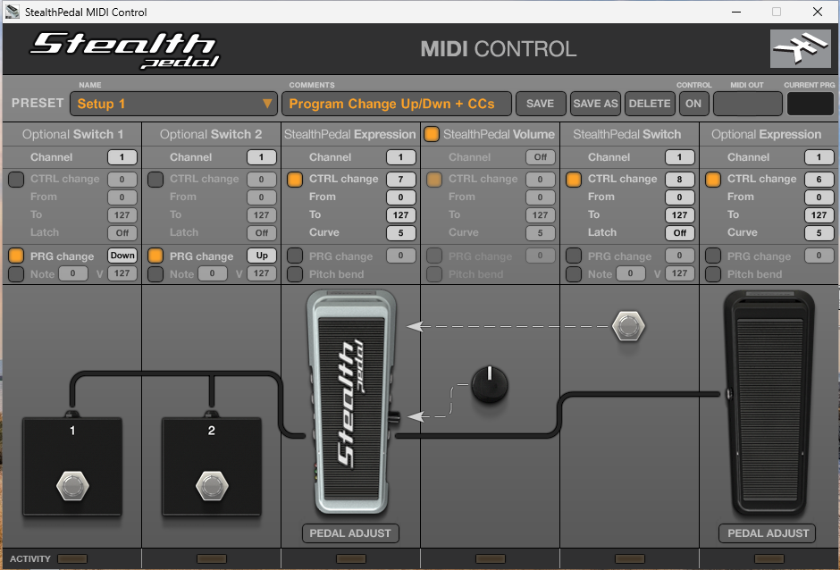
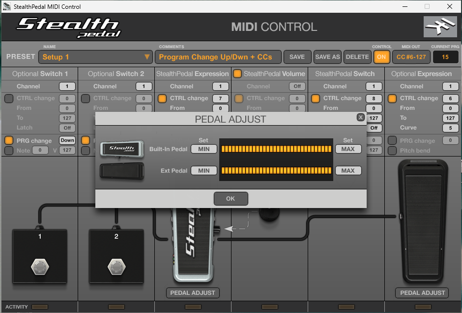

# Windows用公式ドライバの解析とUSB通信の記録

Linuxでは読めなかったスイッチとノブの状態を、公式ソフトがどのUSB転送で取り出しているかを知るために、Windows用ドライバの構成と、ドライバが本機に送る転送を記録する。Windows側はホストのwin11 VM（libvirt、snapshot `0.0.0.0.0.0.0.0.1-stealthpedal`）で、Renesasコントローラー0000:06:00.0をdocs/0001-ubuntu-vmと同じ方法でPCIパススルーしている。VMへの操作はホストからSSH（192.168.0.5）で行い、PowerShellの処理は`scripts/`の.ps1をVM内の`C:\IK\scripts\`へ複製して実行する。

## ドライバパッケージ

IK User Areaで配布される`StealthPedal_Windows_Drivers_1.1.0.8_64bit.zip`（SHA-256は`raw/package-inventory.txt`）を使う。中身はInstallShield 12のセットアップ`Install StealthPedal Drivers 1.1.0.8 64bit.exe`と、1ページのリリースノート（64ビットWindows Vista/XP対応を追加）である。zip、その2つの中身、展開後の`setup.ini`のSHA-256は`raw/installers-sha256.txt`にある。

セットアップはUIを表示する前に自身のパッケージを`%TEMP%\{GUID}\Disk1\`へ展開する（`scripts/extract-installer.ps1`）。そこにあるdata1.cab/data1.hdrはInstallShield形式で、ドライバ本体は第2ボリュームに入っている。第2ボリュームは独立したファイルとして展開されないので、セットアップのexeから`ISc(`シグネチャで始まる断片を切り出し、`data2.cab`の名前でunshield（twogood/unshieldをソースからビルド）に渡して展開した（`scripts/carve-installshield.py`）。オフセット1027197からの断片だけがDriverグループを完全に展開できた。得られたファイルの一覧とハッシュは`raw/package-inventory.txt`、cabの目録は`raw/data1-cab-list.txt`にある。バイナリ本体はリポジトリに含めない。

| ファイル | 役割 |
| --- | --- |
| IKStealthPedalLL.inf、IKStealthPedalLL.cat | ドライバパッケージ定義（SHA-256は`raw/package-inventory.txt`） |
| IKStealthPedalLL.sys（x64はIKStealthPedalLLx64.sys） | 「IK StealthPedal Low-Level Driver」。USBD.SYSを使うWDMドライバで、WMIクラス名にIsoDeviceInformationを持つ |
| IKStealthPedalAPI.dll | アプリからLLドライバへDeviceIoControlする橋渡し。ASIO向けのストリーミング制御と、USBパイプの直接読み書きを提供する（下記） |
| IKStealthPedalASIO.dll | ASIOドライバ（CLSID {CC433045-9829-4b35-BD33-5C33F8C5C816}） |
| IKStealthPedalASIO.exe | ASIOコントロールパネル（バッファサイズ、Input Gain Boost +12dB、ミュート） |
| IKClsCoInst.inf、IKClsCoInst.dll | MEDIAクラスとUSBクラスのコインストーラー（StealthPedal、StompIO、StealthPlug共通） |

IKStealthPedalAPI.dllのエクスポート表（`raw/api-dll-exports.txt`、`scripts/pe-exports.py`で取得）は54関数で、ASIO向けのストリーミング制御（Connect、StartStreaming、SetSampleRate、SetLineInGain、SetMuteControlなど）に加えて、USBパイプを直接扱う関数を持つ。GetUSBPipeInfo、ReadUSBData、WriteUSBData、ReadUSBFifo、WriteUSBFifo、SetUSBFifoControl、GetUSBFifoStatus、ResetUSBPipe、AbortUSBPipe、WaitForSingleUSBFifo、WaitForUSBFifoListである。本機を制御として使うアプリは、この経路でEP 0x04へ書き、EP 0x83から読む（「制御プロトコル」の節）。

### StealthPedal MIDI Controlに同梱されるMIDIドライバ

StealthPedal MIDI Control 1.0.0.1は、本体の実行ファイルとともにドライバパッケージ`IKStealthPedalMidi.inf`（2009年7月10日、IK Multimedia署名）を`C:\Program Files\IK Multimedia\StealthPedal MIDI Control\Driver\`に入れる（目録とSHA-256は`raw/midi-driver/package-inventory.txt`）。INFはルート列挙の仮想デバイス`*IKStealthPedalMidi`にportclsベースのMIDIドライバを割り当て、KSのUARTインターフェイスとして「IK StealthPedal MIDI」というMIDI In/Outポートを作る。付属のIKStealthPedalMidiApi.dllのエクスポートはIKMidiInOpen、IKMidiOutOpen、IKMidiOutShortMsg、IKMidiOutWriteなど17関数で、制御デバイス`\\.\ik_stealthpedal_midi`へのDeviceIoControlで仮想ポートにMIDIを流す（デバイス名はバイナリ内の文字列から。`scripts/extract-strings.sh`で取り出せる）。このドライバは本機のUSB通信に関与しない。MIDI Controlアプリは、LLドライバのAPIで本機から制御データを読み、MIDIメッセージに変換してこの仮想ポートへ書く。

INFはデバイス全体のID`USB\VID_1963&PID_0003`にLLドライバを割り当てる。インストール後のWindowsでは、複合デバイスの子（MI_00のusbaudio、MI_03のHidUsb）が消え、デバイス全体がサービスIKStealthPedalに付く（`raw/pnp-before-ik-driver.txt`と`raw/ik-driver-install.txt`）。公式スタックはHIDクラスを使わず、LLドライバがオーディオと制御の両方の転送を自分で行う。バイナリ内の文字列（WMIクラス名やコントロールパネルの項目名の根拠）は`scripts/extract-strings.sh`で展開物から取り出す。

カタログの署名者はIK Multimedia Production srl（GlobalSign ObjectSign CA、有効期間は2010年7月まで、タイムスタンプ付き、`raw/ik-driver-signature.txt`）で、SSH経由の`pnputil`では「発行元が信頼されていない」で失敗する。署名者証明書をLocalMachineのTrustedPublisherへ入れてから`pnputil /add-driver ... /install`で導入できる（`scripts/install-ik-driver.ps1`）。

## USBPcapによる記録

コントローラーをVMへPCIパススルーしているため、ホストのusbmonでは転送を見られない。VM内でUSBPcap 1.5.4（`USBPcapSetup-1.5.4.0.exe`、署名者Tomasz Moń）を使う。インストーラー類（ドライバzip、USBPcap、VC++再頒布可能パッケージ）のSHA-256は`raw/installers-sha256.txt`にある。このWindows 11（ビルド26300）では、次の点に注意が要る。

- SSH経由のサイレントインストールではフィルタドライバが登録されない。`pnputil /add-driver`でパッケージを登録し、USBPcap.sysをdriversへ置き、カーネルサービスを作り、USBクラスのUpperFiltersに`USBPcap`を追加して再起動する（`scripts/install-usbpcap.ps1`）。
- フィルタは起動時の列挙でデバイスのスタックに装着される。装着の有無は`pnputil /enum-devices /stack`で確かめる（`scripts/device-stacks.ps1`）。`pnputil /disable-device`と`/enable-device`を行うとペダルのスタックから外れ、ルートハブの再起動（`scripts/restart-roothub.ps1`）で再び装着されるが、そのとき制御デバイス`\\.\USBPcapN`の番号が変わる。
- 番号は`scripts/find-usbpcap-index.sh`で確定する。各番号で1秒の記録を取り、注入されたディスクリプタに本機のVID/PIDが含まれる番号を選ぶ。
- USBPcapCMDはコンソール入力の`q`で止まる設計で、ウィンドウの無いセッションでは`taskkill`の通常終了では止まらず強制終了になる。書き込みはWriteFileで即時なので、強制終了でも記録は失われない（`scripts/usbpcap-capture.ps1`）。

記録の要約は`scripts/pcap-summary.py`で得る。pcapのリンク種別は249（USBPcap）である。

## 記録結果

`raw/usbpcap-control-panel.pcap`は、ASIOコントロールパネルを起動した6秒間と、その後のアイドル6秒間である。起動時に流れたのは、USB Audio Class 1.0の標準要求だけだった。

| 要求 | 意味 | 応答 |
| --- | --- | --- |
| GET_CUR VOLUME ch1、Feature Unit 6 | 入力ゲイン（L） | 0x0000（0dB） |
| GET_CUR VOLUME ch2、Feature Unit 6 | 入力ゲイン（R） | 0x0000（0dB） |
| GET_CUR MUTE ch0、Feature Unit 5 | 出力ミュート | 0 |
| GET_CUR VOLUME ch0、Feature Unit 5 | 出力ボリューム | 0xF400（-12dB） |

Feature Unit 6と5は、LinuxのALSAが「Analog In Capture Volume」と「PCM Playback Volume/Switch」として公開したものと同じである。コントロールパネルのInput Gain Boostはこの入力ゲインを+12dBにする操作で、LinuxではamixerでFeature Unit 6を操作すれば同じになる。

`raw/usbpcap-replug-and-operate.pcap`は150秒間の記録で、途中で本機を抜き差しし、再列挙の後にペダル・スイッチ・ノブを操作した。

- 抜線時（20.8秒）に、LLドライバはEP 0x83（HIDインターフェイスのインタラプトIN）とEP 0x04（同OUT）に対してURB_FUNCTION_ABORT_PIPEを発行した。ドライバはこの2本のパイプを開いており、EP 0x83には完了しないままのインタラプトIN要求が残っていたことになる。
- 再列挙時（27.7秒）の初期化は、デバイス・コンフィギュレーションディスクリプタの取得、SELECT_CONFIGURATION、インターフェイス0と3のSELECT_INTERFACE（代替設定0）、EP 0x01とEP 0x82へのSET_CUR SAMPLING_FREQ（48000Hz）、Feature Unit 5の出力ボリューム（0xF600、-10dB）とミュート（0）、Feature Unit 6の入力ゲイン（0dB、0dB）のSET_CURで、すべてUSB Audio Class 1.0の標準要求だった。ベンダー固有要求、HIDのSET_REPORT、EP 0x04への出力は無い。
- 初期化後、ペダル・スイッチ・ノブを操作しても転送は1件も記録されなかった。

Linuxでの観察（docs/0002-device-enumeration）と合わせると、本機はホストからコマンドを受け取るまでインタラプトINで何も送らず、LLドライバ単体はそのコマンドを送らない。送るのは本機を制御として使うアプリで、その中身は「制御プロトコル」の節の記録で確定した。

## 制御プロトコル（StealthPedal MIDI Controlの記録）

有効化コマンドを送るのはLLドライバではなくアプリなので、制御の通信はStealthPedal MIDI Control 1.0.0.1（win11の`C:\Program Files\IK Multimedia\StealthPedal MIDI Control\`に導入済み）を動かしながら記録する。アプリの画面は6列で、左からOptional Switch 1、Optional Switch 2、StealthPedal Expression、StealthPedal Volume、StealthPedal Switch、Optional Expressionに対応し、各列にMIDIチャンネル、送出種別（CTRL change、PRG change、Note、Pitch bend）とその値域やカーブ、スイッチのLatchの設定がある。上部にPRESETの保存・読み込み、CONTROLのON/OFF、MIDI OUTモニター、CURRENT PRGの表示があり、下部のACTIVITYが各入力の動きを示す（`raw/midi-control-main.png`。本機を接続していない状態）。

このアプリは起動時からCONTROLがONで、LLドライバのAPIを通じてEP 0x04へコマンドを書き、EP 0x83からレポートを受け取り、同梱の仮想MIDIドライバが作るMIDI入力ポート「IK StealthPedal MIDI」へMIDIメッセージとして流す。記録は、`scripts/find-usbpcap-index.sh`で制御デバイスの番号を確かめ、`scripts/usbpcap-capture.ps1`を十分な秒数で起動してから、アプリを起動して操作する。

記録したのは、アプリの起動、ペダルの往復、スイッチ2回、ノブの回転の306秒間である（`raw/usbpcap-midi-control.pcap`、変化点の一覧は`raw/usbpcap-midi-control-runs.txt`、解析は`scripts/analyze-control-capture.py`）。制御の通信はすべてHIDインターフェイス（インターフェイス3）のインタラプト転送で、EP 0x04へのコマンドとEP 0x83からのレポートからなる。コントロール転送やSET_REPORTは使われていない。

アプリ起動時にホストがEP 0x04へ書いたコマンドは次の4件で、以後の操作中にコマンドは無い。

| 時刻（秒） | バイト列 | 直後の応答 |
| --- | --- | --- |
| 78.293 | `00 04 01` | EP 0x83から1バイト`80`、続いて10バイトのレポートが流れ始める |
| 78.301 | `00 02 00 00` | なし |
| 78.302 | `00 02 00 02` | なし |
| 78.306 | `00 07 03` | なし |

レポート送出を始めるのは先頭の`00 04 01`である。`00 02 00 00`と`00 02 00 02`はLEDの全消灯と緑の点灯、`00 07 03`はアプリの設定「StealthPedal Volume」のON（下記）で、各コマンドの意味はdocs/0004-linux-controlの「コマンド0x02（LED）と0x07（ノブの音量）」で確定している。

この4件はアプリのCONTROLがONになるたびに同じ順で送られ、OFFにしたときとアプリを終了したときにはホストは何も書かない。`raw/usbpcap-midi-control-exit.pcap`（139秒、変化点の一覧は`raw/usbpcap-midi-control-exit-runs.txt`）は、本体に触れずにアプリの起動、CONTROLをOFF、ON、アプリの終了、再起動、再終了を行った記録である。

| 時刻（秒） | 操作 | EP 0x04への書き込み | EP 0x83の読み出し |
| --- | --- | --- | --- |
| 49.926 | アプリ起動 | 4件（`00 04 01`、`00 02 00 00`、`00 02 00 02`、`00 07 03`、20ms以内） | 始まる |
| 52.969 | CONTROLをOFF | なし | 止まる（ホストがIN要求を出さなくなる） |
| 66.118 | CONTROLをON | 同じ4件 | 再開 |
| 81.352 | アプリ終了 | なし | 止まる。ABORT_PIPEも無い |
| 100.422 | アプリ再起動 | 同じ4件 | 再開 |
| 138.483 | アプリ再終了 | なし | 止まる |

ホストが`00 04 00`を送ることは無いので、アプリを終了した後も本機は送出状態のままである（docs/0004-linux-controlの「送出状態の持続」）。再起動時の4件は、本機がすでに送出中でも同じ内容で送られる。

アプリの設定「StealthPedal Volume」（既定でチェック）は、コマンド0x07で本機に伝えられる。`raw/usbpcap-midi-control-volume.pcap`（82秒、変化点の一覧は`raw/usbpcap-midi-control-volume-runs.txt`）は、本体に触れずにアプリの起動、チェックを外す、戻す、アプリの終了を行った記録である。

| 時刻（秒） | 操作 | EP 0x04への書き込み |
| --- | --- | --- |
| 23.723 | アプリ起動 | 4件（`00 04 01`、`00 02 00 00`、`00 02 00 02`、`00 07 03`） |
| 36.543 | StealthPedal Volumeのチェックを外す | `00 07 00` |
| 51.734 | チェックを戻す | `00 07 03` |
| 81.585 | アプリ終了 | なし |

チェックの切り替えごとにホストが書くのはコマンド0x07で、本機からの応答は無く、レポートの送出も途切れない。コントロール転送（USB Audio Classの音量要求）も無い。コマンド0x07の末尾バイトはノブのボリューム機能の有効（0x03）と無効（0x00）で、起動時の4件の最後はこの設定の初期化である。

アプリのMIDI変換に関する設定は、変えても本機への書き込みが無い。記録はいずれも、アプリの起動、設定の変更と復元、アプリの終了を本体に触れずに行ったもので、書き込みは起動時の4件だけである。

| 設定 | 記録 |
| --- | --- |
| StealthPedal ExpressionのChannel（1〜16とOFF） | `raw/usbpcap-midi-control-expression-channel.pcap`（82秒） |
| StealthPedal Expressionの送出種別（CTRL change、PRG change、Pitch bendのいずれか一つ） | `raw/usbpcap-midi-control-expression-mode.pcap`（177秒） |

レポートは10バイトで、静止中は16ms間隔、値が変化している間は最短1.5ms間隔で届く。

| バイト | 内容 | 根拠 |
| --- | --- | --- |
| [0] | 0x81固定 | 全レポートで同じ |
| [1] | 0x02固定 | 同上 |
| [2] | 変化フラグ。0x80を基底に、bit3（0x08）はスイッチの変化、bit2（0x04）はペダルまたはノブの変化、bit0（0x01）はカウンタが0x4000の倍数を跨いだ直後のレポート（約16.8秒ごと）と、`00 04 01`を受けた直後の最初のレポートで立つ | スイッチの押下と解放の直後のレポートだけ0x88、ペダルとノブの移動中は0x84、起動直後の最初のレポートは0x8d。bit0とカウンタの関係はdocs/0004-linux-controlの記録で確認した |
| [3]〜[4] | 16ビットのカウンタ（ビッグエンディアン） | 16ms間隔のレポートで16ずつ増える |
| [5] | スイッチの状態のビット集合。bit0（0x01）は内蔵スイッチ、bit1（0x02）は外部フットスイッチ1（TRSのTip）、bit2（0x04）は外部フットスイッチ2（TRSのRing）。押下中に1 | 内蔵スイッチの2回の踏み込み（110.9〜111.3秒、112.3〜112.6秒）で0x01。外部スイッチは`raw/usbpcap-fs7-footswitch.pcap`（BOSS FS-7をジャックBのステレオ出力で接続、変化点は`raw/usbpcap-fs7-footswitch-runs.txt`）で、スイッチAの踏み込みで0x04、スイッチBで0x02、同時で0x06。外部スイッチの変化でも[2]は0x88になる |
| [6] | エクスプレッションペダルの位置（8ビット）。踵が0x08付近、爪先が0xF2〜0xF7 | 記録の開始時は爪先側（0xF2）にあり、88.2秒からの往復で0x09まで下がって0xF3へ戻る |
| [7] | 外部エクスプレッションペダルの位置（8ビット）。踵側が小さく爪先側が大きい。未接続時は0x02 | 未接続の記録では全レポートで0x02。M-Audio EX-Pを接続した`raw/usbpcap-exp-ex-p.pcap`（変化点は`raw/usbpcap-exp-ex-p-runs.txt`）では、極性スイッチOtherで0x1D〜0xDA、M-Audioで0x05〜0xEB。移動中は[2]が0x84 |
| [8] | ノブの位置（8ビット）。左端が0x00、右端が0xF7 | 118.4秒から上がって120.1秒に0xF7、121.0秒から下がって122.8秒に0x00 |
| [9] | ノブの位置（7ビット、0x00〜0x7F） | [8]と同じ向きに動き、観測した最大は0x7F |

ペダル[6]とノブ[8]は8ビットの生の値で、ノブ[9]はそれを7ビットに丸めたMIDIの値域の値である。アプリのMIDI OUTモニターでは、内蔵ペダルも外部ペダルも踵で0、爪先で127になる。生値の両端（内蔵ペダルは0x08と0xF2、外部ペダルはEX-PのM-Audio側で0x05と0xEB）が0と127に割り当てられているので、7ビットへの換算はアプリが各ペダルの両端の値を使って行っている。

両端の値を取り直すのがPEDAL ADJUSTである。StealthPedal ExpressionとOptional Expressionの各欄にあるボタンはどちらも同じダイアログを開き、Built-In PedalとExt Pedalのそれぞれに現在位置のメーターと「Set MIN」「Set MAX」ボタンがある（`raw/midi-control-pedal-adjust.png`）。

このダイアログはCONTROLがONのときに働く。両ペダルを踵側で「Set MIN」、爪先側で「Set MAX」とした記録（`raw/usbpcap-pedal-adjust-set.pcap`）と、続けて「OK」で閉じてから両ペダルを一往復した記録（`raw/usbpcap-pedal-adjust-ok.pcap`）のどちらにも、EP 0x04への書き込みとコントロール転送は無い。較正はアプリ内で完結し、本機には何も送られない。較正後の往復では生値が内蔵ペダルで0x09〜0xF3、外部ペダルで0x04〜0xEBで、MIDI OUTモニターは0〜127（端で126になることがある）を示した。

GET_REPORTで得られる24バイトは、この10バイトのレポートとは別の構造で、先頭3バイトが現在のサンプリング周波数（再列挙時にドライバが設定する48000Hzなら`80 bb 00`）、[20]が最後に受けたコマンドの長さ、[21]と[22]が出力音量の左右の値である（docs/0004-linux-controlの「GET_REPORTの24バイト」）。Linuxのhidrawでは、インターフェイス3のインタラプトOUTへの書き込みはhidrawのwrite（先頭にレポートID 0を付けた`00 00 04 01`）で行い、レポートはreadで10バイトずつ受け取る（同「方法」）。
